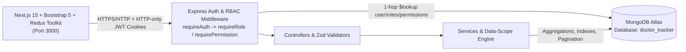

# Doctor Tracker — Clinical Management & Dynamic RBAC Portal

## 1. Project Description

Doctor Tracker is a full-stack clinical administration platform that enables healthcare organizations to securely manage doctors, patients, patient-doctor assignments, and real-time operational analytics through a dynamically configurable Role-Based Access Control (RBAC) engine. Built as two decoupled applications—a responsive Next.js + Bootstrap 5 client and a RESTful Node.js/Express API backed by MongoDB Atlas—it delivers instant permission propagation without requiring re-login, strict backend data-access boundaries for doctors and patients, and unrestricted system oversight for Super Administrators.

---

## 2. Features

- **Secure Authentication & Session Management**:
  - Bcrypt password hashing (`saltRounds: 12`), signed JWT access & refresh tokens stored in HTTP-only cookies, `tokenVersion` revocation support, and account activation/deactivation checks.
  - Automatic token refresh handling in the frontend API client with clean logout and unauthorized redirection.
- **Dynamic Role-Based Access Control (RBAC)**:
  - Three dedicated MongoDB collections (`roles`, `permissions`, `users`) supporting multi-role user accounts and effective permission union across active roles.
  - **Super Admin Bypass & System Protection**: Unrestricted access across all existing and newly created permissions, protection against deleting/deactivating the Super Admin role, protection against deleting/deactivating the final active Super Admin account, and privilege escalation prevention.
  - **Role & Permission Management UI (Super Admin only)**: Create, edit, activate/deactivate, and delete custom roles; assign/remove permissions grouped by module with per-module and global Select All / Deselect All controls; inspect users assigned to any role; register new permissions dynamically.
  - **Live Permission Propagation**: Changes to roles or permissions take effect immediately on backend APIs and sync cleanly in the frontend without forcing users to log out.
- **Doctor Management**:
  - Full CRUD for doctors (`Name`, `Specialization`, `Hospital`, `Phone`, `Email`).
  - Server-side search, specialization/hospital filtering, date-range filtering, and pagination.
  - Dedicated Doctor Detail view (`/doctors/[id]`) to view assigned patients, create or assign patients directly under a doctor, and unassign/remove patients from a doctor's roster.
- **Patient Management**:
  - Full CRUD for patients (`Name`, `Age`, `Gender`, `Phone`, `Email`, `Condition`, `Status`, `Admission Date`, `Notes`, `Assigned Doctor`).
  - Server-side search, medical condition filtering, status filtering, date-wise filtering, pagination, and doctor reassignment.
  - Backend data-access boundaries enforcing doctor-scoped and patient-scoped visibility.
- **Dashboard & Data Visualization**:
  - MongoDB aggregation-powered analytics: Total Doctors, Total Patients, Average Patients per Doctor, Critical Cases, System Users, and RBAC Roles.
  - Interactive Chart.js visualizations (Date-Based Registration Trend, Patients by Condition Doughnut, Patients per Doctor Bar Chart) scoped to user permissions and boundaries.

---

## 3. Technology Stack

| Layer | Technology |
| :--- | :--- |
| **Frontend Framework** | Next.js 15 (App Router, JavaScript) |
| **UI & Styling** | Bootstrap 5 (`bootstrap`), Bootstrap Icons (`bootstrap-icons`), Custom CSS |
| **State Management** | Redux Toolkit (`@reduxjs/toolkit`, `react-redux`) |
| **Data Visualization** | Chart.js (`chart.js`, `react-chartjs-2`) |
| **Backend Runtime** | Node.js (v22+) & Express.js |
| **Database & ODM** | MongoDB Atlas & Mongoose (`doctor_tracker` database) |
| **Validation & Security** | Zod, bcryptjs, jsonwebtoken, cookie-parser, helmet, cors, express-rate-limit |
| **Testing** | Node.js Test Runner (`node --test`), Supertest, Playwright (E2E) |

---

## 4. Installation and Setup Guide

### Prerequisites

- **Node.js** v18+ (tested with v22.22.0) and **npm** v9+
- A **MongoDB Atlas** cluster (cloud URI) with network access allowed for your IP

### Clone & Install

```bash
git clone <your-repository-url>
cd doctor_tracker
```

Install dependencies separately for both applications:

```bash
# Backend dependencies
cd backend
npm install

# Frontend dependencies
cd ../frontend
npm install
```

---

## 5. Environment Variables

Example configuration templates are included in both applications:
- `backend/.env.example`
- `frontend/.env.example`

Never commit real `.env` or `.env.local` files or database credentials to version control.

### Backend (`backend/.env`)

```env
PORT=5000
NODE_ENV=development
MONGODB_URI=mongodb+srv://<username>:<password>@<cluster-url>/doctor_tracker?retryWrites=true&w=majority
JWT_SECRET=<strong_random_secret>
JWT_EXPIRES_IN=1d
JWT_REFRESH_SECRET=<different_strong_random_secret>
JWT_REFRESH_EXPIRES_IN=7d
FRONTEND_URL=http://localhost:3000

SUPER_ADMIN_NAME=System Super Admin
SUPER_ADMIN_EMAIL=<your_super_admin_email>
SUPER_ADMIN_PASSWORD=<your_super_admin_password>
```

### Frontend (`frontend/.env.local`)

```env
NEXT_PUBLIC_API_URL=http://localhost:5000/api/v1
NEXT_PUBLIC_APP_NAME=Doctor Tracker
```

---

## 6. Frontend Setup

```bash
cd frontend
cp .env.example .env.local
# Edit .env.local if your backend runs on a non-default URL
npm run dev
```

For a production build:

```bash
npm run build
npm run start
```

The frontend runs on `http://localhost:3000`.

---

## 7. Backend Setup

```bash
cd backend
cp .env.example .env
# Populate MONGODB_URI, JWT_SECRET, JWT_REFRESH_SECRET, and SUPER_ADMIN_* in .env
npm run dev
```

For production execution:

```bash
npm start
```

Verify server and MongoDB Atlas connectivity:

```bash
GET http://localhost:5000/api/v1/health
```

---

## 8. Database Configuration

- All database connections are managed exclusively by the backend in [`backend/src/config/database.js`](backend/src/config/database.js).
- The frontend never communicates directly with MongoDB.
- All collections (`users`, `roles`, `permissions`, `doctors`, `patients`) belong to the **`doctor_tracker`** database on MongoDB Atlas.
- Startup enforces environment validation, connects to MongoDB Atlas with retry resilience and SRV resolution support, verifies connectivity via `ping()`, and only starts the Express HTTP server after a healthy connection is established.
- Graceful shutdown handlers (`SIGINT`, `SIGTERM`) drain HTTP connections and close Mongoose cleanly.

---

## 9. Database Seeding

Seeding is fully idempotent—running it repeatedly does not create duplicate roles, permissions, or accounts, and preserves any custom role permission edits made via the UI.

```bash
cd backend

# Seed core RBAC system (4 system roles, 21 predefined permissions, initial Super Admin)
npm run seed

# Optional: also seed sample clinic doctors, patients, and demo Admin/Doctor/Patient accounts
npm run seed -- --demo
```

---

## 10. Default Login Instructions

1. Configure `SUPER_ADMIN_EMAIL` and `SUPER_ADMIN_PASSWORD` inside `backend/.env` before starting the backend or running `npm run seed`.
2. Navigate to `http://localhost:3000/login` and sign in using the Super Admin credentials you configured in `backend/.env`.
3. From **Roles & RBAC** (`/roles`), **Permissions** (`/permissions`), and **Users** (`/users`), you can inspect or dynamically customize permissions for **Admin**, **Doctor**, **Patient**, or create new custom roles and users.
4. *(Optional Demo Accounts)* If you ran `npm run seed -- --demo`, sample non-privileged test accounts (`admin@doctortracker.local`, `sarah.jenkins@doctortracker.local`, `john.carter@doctortracker.local`) are seeded using `DEMO_USER_PASSWORD` (defaulting to `Demo@12345` in local development).

---

## 11. System Architecture

Doctor Tracker separates presentation and API concerns into independent applications communicating over versioned JSON REST endpoints with HTTP-only cookie credentials:



---

## 12. API Documentation

Base URL: `/api/v1`

### Health
- `GET /health` — Application uptime and live MongoDB Atlas `doctor_tracker` ping status.

### Authentication (`/auth`)
- `POST /auth/login` — Authenticate with email/password; sets HTTP-only `accessToken` and `refreshToken` cookies.
- `POST /auth/logout` — Clears auth cookies.
- `POST /auth/refresh` — Rotates access & refresh tokens using `refreshToken` cookie.
- `GET /auth/me` *(Auth)* — Returns authenticated user profile, active roles, `isSuperAdmin`, and effective permissions.
- `POST /auth/change-password` *(Auth)* — Updates password and increments `tokenVersion`.

### Users (`/users`)
- `GET /users/assignable-roles` *(Auth + `users.view|users.create|users.update`)* — Lists assignable roles (excludes `super-admin` for non-Super-Admin callers).
- `GET /users` *(`users.view`)* — Search, filter (`roleId`, `isActive`), paginate users.
- `GET /users/:id` *(`users.view`)* — Get user details.
- `POST /users` *(`users.create`)* — Create user with multi-role assignment.
- `PUT /users/:id` *(`users.update`)* — Update profile, roles, password, or active status.
- `DELETE /users/:id` *(`users.delete`)* — Delete user account (protected against self-delete and final Super Admin removal).

### Roles & Permissions (`/roles`, `/permissions` — Super Admin Only)
- `GET /roles` *(`super-admin` + `roles.view`)* — Paginated list with aggregated permission counts & assigned user counts.
- `GET /roles/:id` *(`super-admin` + `roles.view`)* — Role details with populated permissions.
- `POST /roles` *(`super-admin` + `roles.create`)* — Create custom role.
- `PUT /roles/:id` *(`super-admin` + `roles.update`)* — Update role details.
- `PATCH /roles/:id/activate` *(`super-admin` + `roles.activate`)* — Activate role.
- `PATCH /roles/:id/deactivate` *(`super-admin` + `roles.deactivate`)* — Deactivate role (Super Admin protected).
- `PUT /roles/:id/permissions` *(`super-admin` + `roles.assign_permissions`)* — Replace role permissions.
- `GET /roles/:id/users` *(`super-admin` + `roles.view_assigned_users`)* — Paginated users assigned to a role.
- `DELETE /roles/:id` *(`super-admin` + `roles.delete`)* — Delete non-system custom role.
- `GET /permissions` *(`super-admin` + `roles.assign_permissions`)* — Flat & module-grouped permission catalog.
- `POST /permissions` *(`super-admin` + `roles.assign_permissions`)* — Register a new dynamic permission.

### Doctors (`/doctors`)
- `GET /doctors` *(`doctors.view`)* — Aggregated list with `patientCount`, search, specialization/hospital/date filters, pagination.
- `GET /doctors/:id` *(`doctors.view`)* — Doctor details (scoped by data boundary).
- `POST /doctors` *(`doctors.create`)* — Create doctor.
- `PUT /doctors/:id` *(`doctors.update`)* — Update doctor.
- `DELETE /doctors/:id` *(`doctors.delete`)* — Delete doctor and unassign linked patients.
- `GET /doctors/:id/patients` *(`doctors.view` + `patients.view`)* — Paginated patients assigned to doctor.
- `POST /doctors/:id/patients` *(`patients.create|patients.update|doctors.update`)* — Create or assign a patient under doctor.
- `DELETE /doctors/:id/patients/:patientId` *(`doctors.update|patients.update|patients.delete`)* — Remove patient from doctor's roster.

### Patients (`/patients`)
- `GET /patients` *(`patients.view`)* — Paginated patient list with search, condition, status, doctor, and date filters.
- `GET /patients/:id` *(`patients.view`)* — Patient details (scoped by data boundary).
- `POST /patients` *(`patients.create`)* — Create patient.
- `PUT /patients/:id` *(`patients.update`)* — Update patient.
- `PATCH /patients/:id/assign-doctor` *(`patients.update`)* — Assign or unassign attending doctor.
- `DELETE /patients/:id` *(`patients.delete`)* — Delete patient.

### Dashboard (`/dashboard`)
- `GET /dashboard` *(`dashboard.view`)* — Permission-aware & scope-aware KPI metrics, patients-per-doctor, condition distribution, and date registration trends.

---

## 13. RBAC Architecture

- **Collections**:
  - `permissions`: Defines granular `module.action` slugs (`dashboard.view`, `doctors.*`, `patients.*`, `users.*`, `roles.*`).
  - `roles`: References `permissions[]`, tracks `isActive` and `isSystem` (`super-admin`, `admin`, `doctor`, `patient`).
  - `users`: References `roles[]` (multi-role support) and tracks `isActive` + `tokenVersion`.
- **Effective Permission Resolution**:
  - On each request, `requireAuth` evaluates only **active** roles (`role.isActive === true`) assigned to an **active** user (`user.isActive === true`) and computes the union of their permission slugs.
  - **Super Admin Bypass**: Active `super-admin` role holders automatically pass `requirePermission` without relying on manual permission assignments and automatically gain access to newly created permissions.
- **System Protections**:
  - Only `super-admin` can access `/roles` and `/permissions` management endpoints (`requireRole('super-admin')`).
  - Non-Super-Admin users cannot assign `super-admin` or modify Super Admin accounts.
  - System roles cannot be deleted; `super-admin` role cannot be deactivated; the final active Super Admin account cannot be deactivated, deleted, or stripped of its Super Admin role.
- **Data-Access Boundaries**:
  - Users whose active roles are limited to `doctor` can only view/manage patients assigned to their linked Doctor profile.
  - Users whose active roles are limited to `patient` can only view their own Patient record and assigned Doctor.

---

## 14. Technical Decisions

1. **Redux Toolkit + HTTP-Only Cookies over React Context + `localStorage`**:
   - Storing authentication state (`user`, `roles`, `permissions`, `isSuperAdmin`) in a dedicated Redux store (`authSlice`) avoids unnecessary provider re-renders across deep dashboard tables and modals when UI state (`uiSlice` toasts/sidebar) updates.
   - Pairing Redux with HTTP-only JWT cookies (`credentials: 'include'`) and a deduplicated refresh lock in `apiClient.js` prevents XSS token theft via `localStorage` while supporting seamless silent refresh and instant permission re-sync (`fetchCurrentUser`) on window focus or RBAC mutations.
2. **Per-Request Single-Query `$lookup` Aggregation for Live RBAC Propagation**:
   - Embedding permissions inside JWT claims forces users to log out and back in before role edits take effect and risks stale authorization after role deactivation.
   - Instead, JWTs carry only minimal identity (`sub`, `tokenVersion`), and `resolveUserAuthContext` executes a single MongoDB `$lookup` aggregation across `users -> roles -> permissions` per request. This eliminates sequential Mongoose `.populate()` round-trips over cloud Atlas latency while guaranteeing immediate enforcement of role deactivation, permission revocation, and user deactivation.

---

## 15. Screenshots

### Desktop Views

#### Login Portal


#### Clinical Analytics Dashboard


#### Doctor Management


#### Patient Management


#### Role Management (Super Admin)


#### Module-Grouped Permission Assignment Modal


#### Permission Assignment Matrix


### Mobile Views

#### Responsive Mobile Dashboard & Offcanvas Navigation
| Mobile Dashboard | Mobile Offcanvas Navigation |
| :---: | :---: |
|  |  |
